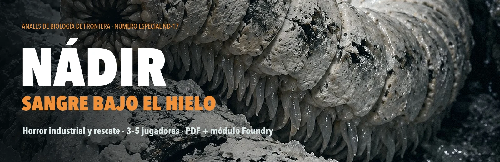
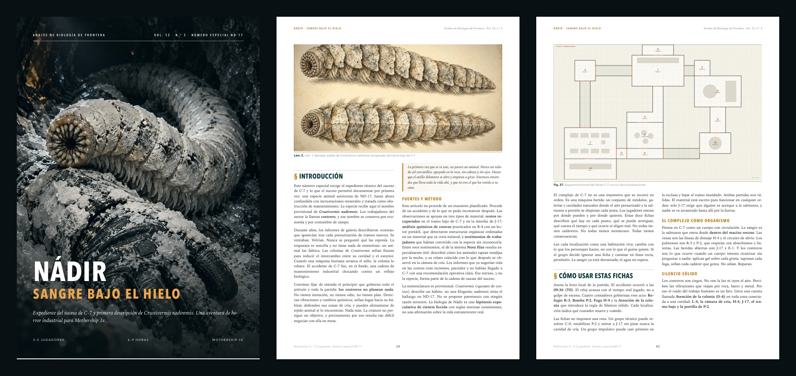

<p align="center">
  
</p>

<p align="center">
  <a href="https://github.com/ManuRomera/mr-nadir/releases/latest"></a>
  
  <a href="https://github.com/ManuRomera/mr-nadir/releases"></a>
  
  <a href="LICENSE"></a>
</p>

<h3 align="center">Trece personas en un refugio para diez. Dos que no pueden soltar una bomba.<br>Y algo ciego que sella las grietas del hielo. Para ellos, un cadáver también es una grieta.</h3>

<p align="center"><sub>🇬🇧 <a href="#-english">Read in English</a></sub></p>

---

## ⚡ Instalación en 10 segundos

Necesitas el sistema **MoSh – Unofficial Mothership** (`mosh`). En Foundry: **Add-on Modules → Install Module → Manifest URL**, pega:

```
https://github.com/ManuRomera/mr-nadir/releases/latest/download/module.json
```

Activa **MR- Nádir** en un mundo Mothership, abre el compendio **MR- Nádir: Sangre bajo el hielo** y pulsa **Import**. El **Panel de emergencia** del Guardián está en los **Controles de token** (y en una macro).

El **PDF** —un número especial de *Anales de Biología de Frontera* dedicado al descubrimiento de *Crustivermis nadirensis*— está en cada [release](https://github.com/ManuRomera/mr-nadir/releases/latest) como `Nadir-Sangre-bajo-el-hielo.pdf`.

<p align="center">
  
</p>

## 🧊 De qué va

**Nádir** es una luna minera penitenciaria. La cuadrilla de los jugadores —presos de confianza, una operadora civil y su alguacil— está reparando una bomba cuando llega el último mensaje de **Mara Venn** desde el sector C-7: una entrada de salmuera a presión, compuertas cerrándose, heridos. Luego, estática.

- 👥 **3–5 jugadores**, 6–9 h (idealmente dos sesiones), **Mothership 1e**.
- ⏱️ **Tres relojes físicos**: el CO₂ de R-3, el filtro y la batería de P-2, la Fuga H-4. Nadie gana por tirar dados: se gana por resolver presión, aire, tiempo y custodia.
- ⚖️ **Un dilema que nace de la física**: sacar a los dos de P-2 sin sustituir su bomba condena a los trece de R-3. Uno de ellos es un homicida que, además, agravó el desastre.
- 🪱 **Los costreros**: fauna ciega que sella fugas. No planean nada. Sellan. Y los muertos, para ellos, también son fugas.

> ⚠️ Contenido: muerte de conocidos, cadáveres, mordeduras, asfixia por CO₂, privación de libertad y violencia carcelaria. Incluye guía de seguridad en mesa.

## 📦 Qué trae

| | |
|---|---|
| 📖 **Guía del Guardián** | Cuatro actos, doce localizaciones, cinco planes de rescate y seis finales, en 25 diarios con una página por localización. |
| 🔬 **Artículo científico** | *Crustivermis nadirensis*: morfología, conducta, láminas, fichas y la mecánica de **Silencio sólido** (Atención de la colonia). |
| 🧾 **14 documentos** | Mensaje cortado de Mara, registro de presión, nota de la bomba, la radio abierta de Serrat, el expediente de evasión de Lisán… |
| 🧑‍🤝‍🧑 **PNJ y cuadrilla** | Mara, Quiroga, Ivo, Kroll y compañía; 5 pregenerados; costreros. **Tokens de cuerpo entero y sin fondo.** |
| 🗺️ **Mapas** | Sector C-7 con muros, puertas y chinchetas a cada localización; Frente B-4; rutas de superficie. |
| 🎬 **Escenas de cada estancia** | 25 escenas de imagen (sin personajes) enlazadas desde su zona del mapa: el Guardián las muestra a todos con un botón y vuelve al mapa con otro. Cada una con su **lectura** en segunda persona, su **música** y su **ambiente**, que arrancan solos al entrar. |
| 🟢 **Mapas de fósforo** | Pantalla verde de terminal con barrido de radar y ecos al moverse. Muros, puertas, niebla de guerra, linternas en los trajes, zonas más oscuras y **regiones**: avisan al Guardián cuando un PJ entra en una sala y teletransportan entre la superficie, B-4 y C-7. |
| 🎧 **Banda sonora original** | 10 pistas y 25 efectos compuestos por síntesis para el módulo (licencia propia): misma paleta de drones, hielo, metal y sónar. Botones de efecto manual en cada escena. |
| ★ **Guion de dirección** | Diario con toda la partida y botones para mostrar escenas, volver al mapa, lanzar efectos y música, mostrar documentos, arrastrar PNJ y objetos y mover el reloj. |
| 🚨 **Panel de emergencia** | Hora T+, margen de R-3, filtro y batería de P-2, Fuga H-4, energía del rover, cartuchos y Atención de la colonia; publica el estado en el chat. |
| 🖨️ **PDF de revista** | Maquetado como un número especial de exobiología, con láminas a sangre, fichas y hojas imprimibles. |

## 🤖 AI disclosure

Historia, canon y dirección: Manuel Romera. El texto final se redactó por capítulos con modelos de lenguaje (DeepSeek v4.1 Flash vía opencode, coordinados por Claude) sobre el manuscrito del autor y se revisó contra él. **Las imágenes están generadas con IA** (Codex, modelo gpt-5.6-luna) y gradadas; los planos se generan por código. La **música y los efectos** se sintetizan desde cero con `tools/audio.py` (obra original del módulo, misma licencia). Detalles en [`NOTICE.md`](NOTICE.md).

## 📜 Licencia

Texto, planos y arte: **CC BY-NC-SA 4.0** © 2026 Manuel Romera Chinchilla. *Mothership* es una marca de Tuesday Knight Games; esta obra es independiente, no oficial y no reproduce sus reglas.

---

<a id="-english"></a>

## 🇬🇧 English

**MR- Nádir: Sangre bajo el hielo** ("Blood under the ice") is a complete industrial-horror rescue scenario for **Mothership 1e** (3–5 players, 6–9 h), written in Spanish. A crew of trusted convicts and their marshal answer a cut-off distress call from a flooded mining sector on a penal ice moon, where blind crust-worms seal every leak — corpses included. Includes a scientific-journal style PDF and a ready-to-import Foundry VTT **v13** adventure (journals, full-body tokens, walled maps, tables, macros and an emergency clock panel).

**Install:** *Add-on Modules → Install Module → Manifest URL*:

```
https://github.com/ManuRomera/mr-nadir/releases/latest/download/module.json
```

Requires the `mosh` system.
